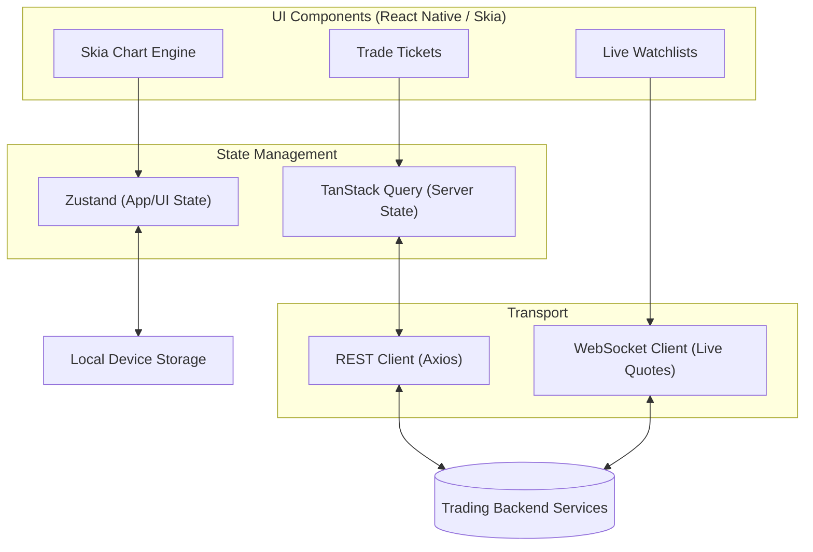

# RTX-5 Mobile Application: Official Engineering Documentation

> **Status:** Active Development | **Platform:** iOS & Android (React Native) | **Phase:** 07 (Hardening)

## 📌 1. Project Abstract & Vision

**What is RTX-5?**
RTX-5 is a state-of-the-art, institutional-grade mobile trading application. It provides real-time financial market data, advanced interactive charting, and immediate order execution capabilities. 

**Core Philosophy:**
The project is architected strictly as a **frontend mobile client**, interfacing with a centralized backend via REST APIs and WebSockets. The primary engineering goal is to achieve **near pixel-perfect UI parity** with provided design reference screenshots, while maintaining uncompromising performance (60 FPS charting), stringent strict-mode type safety, and robust over-the-air (OTA) update capabilities.

---

## 🏗️ 2. High-Level Architecture

The application implements a decoupled, highly responsive architecture designed to handle high-frequency tick data without dropping frames or blocking the UI thread.



### Key Engineering Decisions
*   **Optimistic UI:** When a user modifies or closes a position, the interface instantly reflects the action via local Zustand store mutations before the server synchronizes, guaranteeing zero input lag.
*   **Local Device Persistence:** User preferences (watchlist items, historical filter permutations, custom chart objects) are persisted strictly on the device level natively using unified storage abstractions. Hardcoded runtime values are strictly forbidden.
*   **White-label Policy:** The custom charting engine is built entirely natively atop **React Native Skia**, completely freeing the application from third-party branding constraints or licensing logos.

---

## 🛠️ 3. Technology Stack

To guarantee high framerates, maintainable code, and predictable data flow, RTX-5 relies on a strictly governed technology stack:

| Category | Technology | Purpose & Justification |
| :--- | :--- | :--- |
| **Core Framework** | React Native (Expo) | Cross-platform mobile delivery with native compilation. |
| **Language** | TypeScript (Strict) | Prevents runtime errors and enforces rigorous data contracts. |
| **Server State** | TanStack Query | Manages API lifecycle, request deduplication, and cache freshness. |
| **App State** | Zustand | Lightweight, un-opinionated global state for user sessions and UI toggles. |
| **Forms/Validation** | React Hook Form + Zod | Ensures rigorous, type-safe user inputs (e.g., trade tickets, login). |
| **Graphics Engine**| React Native Skia | Powers the 60fps custom candlestick charting dashboard. |
| **Deployment** | EAS Update | Over-The-Air (OTA) deployments to `preview`, `staging`, and `production`. |

---

## 📂 4. Repository Structure & Domains

The `src/` directory is logically separated by **feature domain** rather than technical type, adhering to modern front-end modularity standards:

```text
rtx5-app/
├── app/                  # Expo Router structural layouts and screen definitions
├── src/
│   ├── api/              # REST API clients and WebSocket transport layers
│   ├── components/       # Shared UI primitives (Buttons, Inputs, Modals)
│   ├── features/         # Core business logic domains
│   │   ├── chart/        # Skia drawing, timeframe logic, indicator plugins
│   │   ├── history/      # Historical position accounting and range filters
│   │   ├── quotes/       # Real-time list management and swipe-to-trade 
│   │   ├── settings/     # Global configuration, passwords, and broker directory
│   │   └── trade/        # Order tickets, bulk operations, and active positions
│   ├── query/            # TanStack Query keys, mutations, and fetcher hooks
│   ├── state/            # Zustand stores (e.g., userPreferences)
│   ├── theme/            # Design system tokens, colors, and layout spacing
│   └── utils/            # Pure helper functions (math, formatting, date logic)
└── docs/                 # Architectural guidelines, API contracts, and QA checklists
```

---

## 🚀 5. Getting Started (Developer Onboarding)

### Prerequisites
1.  **Node.js** (v18+ recommended)
2.  **Expo CLI** (`npm i -g expo-cli`)
3.  **iOS Simulator** / **Android Studio** for local testing.

### Local Initialization
```bash
# 1. Clone the repository
git clone <repository-url>

# 2. Install dependencies
npm install

# 3. Start the bundler and Expo Dev Server
npm start
```

---

## 📋 6. Development Phasing & Roadmap

The project adheres to a strict 9-phase integration strategy. All work is mapped to the `docs/guide/MASTER_GUIDE.md`:

- [x] **Phase 00:** Foundation (Tooling, Baseline, CI)
- [x] **Phase 01:** Design System & Navigation Shell
- [x] **Phase 02:** Quotes Parity & Watchlists
- [x] **Phase 03:** Custom Chart Engine Parity
- [x] **Phase 04:** Trade Execution & Order Tickets
- [x] **Phase 05:** Historical Data & Filtering
- [x] **Phase 06:** Settings, News, & Account Connectors
- [ ] **Phase 07:** Hardening (Security, Analytics, Profiling) **[<-- CURRENT PHASE]**
- [ ] **Phase 08:** Beta Release & Staged Rollout

---

## 🤝 7. Contribution & QA Guidelines

To ensure enterprise-grade stability, all engineers must adhere to the following hand-off protocol:

1. **Strict Feature Mapping:** Every pull request must implement a UI component cross-referenced directly from the `UI_PARITY_SCREEN_MAP.md`.
2. **Phase Adherence:** PRs must reference an open Acceptance Criteria item from the active `PHASE_XX.md` file.
3. **No Backend Alterations:** Modifying the backend logic to accommodate frontend shortcomings is strictly forbidden. The mobile client must adapt to the established `API_CONTRACTS.md`.
4. **Agentic Workflows:** When utilizing internal AI developer setups, invoke specific orchestration agents (e.g., `/feature`, `/deploy`) and await automated test sweeps via `qa_agent` before merging. 

---
*Maintained by the Mobile Platform Engineering Team. For infrastructure questions, refer to `ARCHITECTURE.md`.*


read the full codebase and tell me is there anythings need to check in the backend ? if yes then give the prompt for the backend so that backend check it and give the prompt for the frontend so that frontend will fix that 