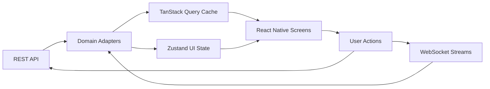

# RTX5 Frontend Architecture

## Summary
RTX5 is a frontend-only React Native app built with Expo Dev Client. It consumes existing backend REST and WebSocket contracts through typed adapters and renders a near parity trading UX across phone and tablet form factors.

## Module Boundaries
- `app/`: Expo Router routes and layout groups.
- `src/ui/`: Design-system primitives and shared widgets.
- `src/features/quotes/`: Quotes list, table, search, symbol details, edit mode.
- `src/features/chart/`: Skia chart engine, timeframe menu, objects, indicators, chart settings.
- `src/features/trade/`: Account summary, positions, trade actions, order ticket.
- `src/features/history/`: Positions/orders/deals history views, sorting/filtering/report entry.
- `src/features/settings/`: Settings, accounts, brokers, mailbox, news, journal placeholders.
- `src/api/generated/`: OpenAPI-generated REST client.
- `src/api/ws/`: WebSocket transport and event subscriptions.
- `src/domain/`: DTO normalization and business mapping.
- `src/state/`: Zustand slices for UI/session state.
- `src/query/`: TanStack Query client setup and query keys.
- `src/security/`: Secure storage, lock state, pinning integration, integrity checks.
- `src/observability/`: Sentry and Crashlytics adapters.

## Navigation Map
- Root tabs:
1. Quotes
2. Chart
3. Trade
4. History
5. Settings

- Stack/presented screens:
1. Quotes: SymbolDetails, QuoteActions, EditSymbols
2. Chart: TimeframePicker, ObjectsManager, ChartSettings
3. Trade: OrderTicket, BulkOperations, OneClickTerms
4. History: Filters, SortMenu, ReportTrigger
5. Settings: Accounts, Brokers, Mailbox, News, Journal, Interface

## Phone vs Tablet Rules
- Phone:
1. Single-pane tab flow.
2. Context menus and detail views as modal sheets or pushed screens.

- Tablet:
1. Adaptive split panes where possible:
- Quotes list + symbol detail pane.
- Trade positions + ticket pane.
- History list + filter pane.
2. Persistent side panels for filters on large widths.
3. Rotation support with state preservation.

## Data Flow

## State Ownership
- TanStack Query:
1. Account snapshot.
2. Quotes and symbol metadata.
3. Positions, orders, deals history.
4. News and mailbox collections.

- Zustand:
1. Active symbol and timeframe.
2. UI modal/sheet state.
3. Unsaved order ticket form state.
4. Session lock/biometric gate state.

## Local Persistence Policy (Device-Only)
- All user-personalized frontend state must persist on-device and survive app restarts until the user changes it.
- Required persisted domains:
1. Quote watchlist edits (added/removed symbols) and selected quote view mode.
2. Chart context (active symbol/timeframe) and drawing/object state.
3. Trading UX consent state (one-click trading acceptance).
4. History filter selections and user-selected preferences.
- Storage implementation: versioned Zustand persisted store under `src/state/` with migration-safe schema updates.
- Never hardcode runtime user values directly in screen files. Use persisted store, backend data, or typed defaults only.

## Performance Budgets
- Quotes screen scroll: 55+ FPS on baseline devices.
- Chart interaction: 45+ FPS during pan/zoom with active overlays.
- Tab switch to interactive: under 400 ms cached path.
- Cold start target: under 3.5 s on mid-tier Android test device.

## Offline and Reconnect
- Cache last known quotes/account snapshot for read-only fallback.
- Reconnect WebSocket with exponential backoff + jitter.
- Mark stale data clearly in UI.

## Architectural Guardrails
- No backend business logic duplication in UI layer.
- No direct API calls from components; go through domain/query hooks.
- No third-party chart logo rendered in chart surface.
